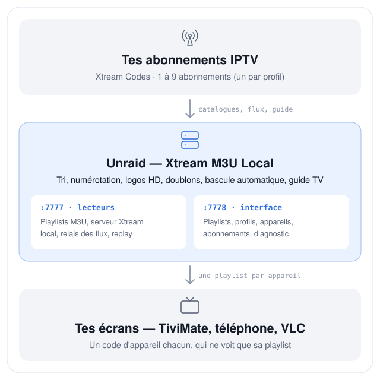

# Xtream M3U Local

Conteneur Docker pour Unraid : **une API Xtream fonctionnelle suffit**, même si le fournisseur ne renvoie rien sur `get.php`.
Le service lit `player_api.php` — TV en direct, films, séries, guide des programmes — conserve le catalogue d'origine du
fournisseur et le redistribue sur ton réseau local, **sans jamais exposer tes identifiants** :

- des **playlists M3U personnalisées à URL permanente** (VLC, TiviMate, lecteurs Android TV…) ;
- un **serveur Xtream Codes local** : chaque TV se connecte en mode « Xtream » avec ses propres identifiants et retrouve
  les rubriques natives Direct / Films / Séries, le guide et le replay, limités à la playlist choisie.

| Port | Rôle | Exemples |
|---|---|---|
| **7777** | Lecteurs IPTV | `http://IP_UNRAID:7777/p/salon.m3u` · `/p/salon.xml` · `player_api.php` · `/stream/<id>.ts` · `/hls/<id>.m3u8` |
| **7778** | Interface Web de gestion | `http://IP_UNRAID:7778/` |

<p align="center"></p>

Les TV ne parlent qu'au serveur ; lui seul parle aux fournisseurs. Un profil = un abonnement, comme un serveur à part. Les gros catalogues se mettent à jour la nuit, doucement. Tout est gardé dans `/data`.

Aucun abonnement n'est fourni : utilise uniquement des flux pour lesquels tu disposes des droits.

## Démarrage rapide

```bash
git clone https://github.com/rachid598/xtream-m3u-local.git
cd xtream-m3u-local
cp .env.example .env      # puis renseigner XTREAM_URL, XTREAM_USERNAME, XTREAM_PASSWORD
docker compose up -d --build
```

1. Ouvre `http://IP_UNRAID:7778/`.
2. **Mes playlists → + Nouvelle** : nomme la playlist (« Salon »), choisis le contenu (tuiles **TV en direct / Films / Séries**), coche des catégories, affine élément par élément, **Créer la playlist**.
3. **Appareils → Ajouter** : « TV du salon » avec la playlist « Salon ». L'interface affiche, prêts à copier :
   - **mode « Playlist M3U »** : URL de la playlist et du guide ;
   - **mode « Xtream Codes »** : serveur `http://IP_UNRAID:7777`, identifiant, mot de passe.
4. Saisis l'un des deux dans le lecteur. Une modification de la playlist dans l'interface est prise en compte au prochain rechargement, **sans changer d'URL**.

Les données (`playlists.json`, `devices.json`, caches EPG et séries) sont dans `./data` (ou `DATA_PATH`), monté sur `/data`.
Elles survivent aux redémarrages, mises à jour et recréations du conteneur.

### Variantes d'installation

- **Un seul fichier à modifier** : `cp compose.single.example.yaml compose.single.yaml`, remplir les 3 valeurs `XTREAM_*`, puis `docker compose -f compose.single.yaml up -d --build` (fichier ignoré par Git).
- **Sans Compose** : `sh docker-create.sh` (build local), `sh docker-create.sh --ghcr` (image GHCR), `--replace` pour recréer en gardant les données.
- **Image GHCR** (construite par GitHub Actions) : `docker compose -f compose.ghcr.yaml up -d`. Si le package est privé : `docker login ghcr.io` avec un jeton GitHub `read:packages`, ou rendre le package public.
- **Template Unraid** : copier `unraid-template.xml` dans `/boot/config/plugins/dockerMan/templates-user/my-xtream-m3u-local.xml`, puis Docker → Add Container.
- **Installation guidée par un agent** : voir `PROMPT_HERMES_UNRAID.md`.

## Interface Web (port 7778)

Entièrement en français, responsive (téléphone, tablette, ordinateur), thème clair/sombre automatique. Cinq vues :

**Mes playlists** : l'éditeur est rangé en quatre parties — **Contenu** (types, catégories, chaînes, ajouts et exclusions), **Organisation** (Mes groupes, ordre et noms des groupes, favoris, personnalisations), **Options** et **Guide**.
- tuiles **TV en direct / Films / Séries** (disponible chez le fournisseur / sélectionné) et bandeau « Ajouter des films / séries » ;
- catégories avec compteurs, filtres, tout cocher / décocher ; **règles automatiques** (« le nom commence par FR | »…) qui ajoutent aussi les futures catégories ;
- recherche (sans accents, plusieurs mots, année), ajout ou exclusion individuelle, actions groupées, affiches, note, bouton « Voir les épisodes » ;
- **☆ favoris** (groupe en tête de la playlist), **✎ personnalisation** : nom, numéro de chaîne (zapping et ordre), **logo de remplacement**, **guide emprunté à une autre chaîne** ; **numérotation automatique** ; **▶ aperçu** de la chaîne dans le navigateur ;
- **📁 Mes groupes de chaînes** (partie « Organisation ») : crée tes propres groupes du direct — « TNT », « Canal+ », « Sport »… — placés **en tête de la playlist**. Modèles prêts (**OTT** : 188 chaînes françaises dans l'ordre de la catégorie « FRANCE HD | OTT » d'un fournisseur ; **Bouquet Canal+** : toutes les chaînes de l'offre Canal+ rangées par thème comme sur le décodeur ; TNT dans l'ordre des numéros ; Chaînes Canal+ ; Sport, Info, Cinéma, Jeunesse, Documentaires) ou groupe vide « + Nouveau groupe en premier ». Un groupe se remplit tout seul avec les chaînes retenues dont le nom correspond (« contient » ou « est exactement », sans tenir compte du pays « FR: », des accents ni de HD/FHD/4K), et le bouton **📁** d'une chaîne la range à la main dans un groupe (ou la laisse dans son groupe d'origine). Écrire « 4: Canal+ » donne aussi le numéro 4 à la chaîne (comme sur un décodeur). Une chaîne rangée quitte son groupe d'origine ; si elle correspond à plusieurs groupes, elle va dans le plus haut ;
- options : format **MPEG-TS ou HLS**, **replay**, **masquer les doublons SD/HD/FHD/4K**, **versions 4K / UHD en dernier secours** (par défaut : beaucoup de « 4K » de fournisseurs sont des chaînes d'événement ou une vidéo de logo en boucle, ex. « M6 4K » ; au choix aussi « comme les autres » ou « jamais »), **bascule automatique** entre ces versions, **masquer les fausses chaînes** (séparateurs « #### PRIME #### », « ♣♦♣--- … ---♣♦♣ » et emplacements « NO EVENT STREAMING »), nom du groupe des favoris ;
- bloc **Guide des programmes (EPG)** : URL, couverture (« Mes groupes » à part), chaînes sans programme, actualisation. Le guide complété par l'API est récupéré d'abord pour les favoris et « Mes groupes » ; une chaîne sans programme reprend le guide d'une de ses autres versions (doublons masqués).

**Guide TV** : ce qui passe **maintenant**, **ce soir à 21 h** ou **demain soir** sur les chaînes d'une playlist (favoris et « Mes groupes » d'abord, filtre « mes chaînes seulement »), barre de progression et programme suivant, **recherche** dans les programmes des 7 prochains jours (« match », « film »…), bouton **▶ aperçu**.

**Aperçu dans le navigateur** : lecteur HLS embarqué (hls.js 1.5.20, licence Apache 2.0, dans `app/static/vendor/`, sans CDN) qui lit `/hls/<id>.m3u8`. Il utilise une connexion de l'abonnement (libérée à la fermeture). Les flux HEVC/4K ne sont souvent pas lisibles par les navigateurs.

**Catalogue fournisseur** (lecture seule) : ordre exact, identifiants, `parent_id`, chaînes / films / séries, recherche, **export JSON** (identifiants masqués).

**Appareils** : un code par TV ou téléphone, identifiants Xtream locaux, playlist associée, **priorité** (haute / normale / basse) et **adresse IP** facultative, nouveau code, suppression ; option **« exiger un code d'appareil »** pour le port 7777.

**Système** : abonnement (statut, expiration, connexions, fuseau), **lectures en cours** (appareil, bascules) avec bouton « Arrêter », **historique** (chaînes les plus regardées, chaînes qui basculent), **diagnostic en un clic**, **sauvegarde / restauration**. Un bandeau prévient quand l'abonnement expire dans moins de 14 jours.

## Mode Xtream Codes local

Dans le lecteur (TiviMate, IPTV Smarters…), choisir « Xtream Codes » et saisir l'adresse `http://IP_UNRAID:7777` avec l'identifiant et le mot de passe d'un appareil (vue Appareils).

- `player_api.php` : compte, catégories et listes (direct, films, séries), fiches détaillées (`get_vod_info`, `get_series_info`), guide court ;
- lecture : `/live|movie|series/<identifiant>/<code>/<id>.<ext>`, replay `/timeshift/…`, `get.php` et `xmltv.php` avec identifiants ;
- l'appareil ne voit que sa playlist (noms, numéros, ordre, groupes perso et doublons compris) ; sans playlist associée, tout le catalogue.

## Playlists M3U

- **TV en direct** → `/stream/<id>.ts` (ou `/hls/<id>.m3u8` en HLS) ; **films** → `/movie/<id>.<ext>` ; **épisodes** → `/series/<id>.<ext>`, nommés `Série S01 E02 - Titre` ;
- en-tête `url-tvg` / `x-tvg-url` → guide de la playlist ; attributs `tvg-id`, `tvg-name`, `tvg-logo`, `tvg-chno`, `group-title` ;
- **replay** : `catchup="default" catchup-days="N" catchup-source="…/timeshift/<id>.ts?start={utc}&end={utcend}"` sur les chaînes qui le proposent ;
- `?content=live|vod|series` (combinables), `?format=m3u8|ts` sur la même URL ; réponses compressées (gzip) et ETag/304 ;
- règle de sélection : (catégorie cochée **ou** ajoutée par une règle **ou** élément ajouté) **et** élément non exclu.

## Relais HLS

Option par playlist (ou `?format=m3u8`) : le serveur télécharge le manifeste HLS du fournisseur et **réécrit chaque lien** (segments, variantes de qualité, pistes audio, clés de chiffrement, segment d'initialisation) vers une adresse locale opaque `/hls/s/<code>.ts`. Le lecteur ne voit jamais l'URL du fournisseur. Utile si le flux MPEG-TS se fige ou coupe souvent.

## Limite de connexions

Un abonnement autorise souvent une seule connexion. Le serveur compte les lectures (direct, HLS, films, épisodes, replay) par fournisseur :

- limite = valeur de l'abonnement (`MAX_CONNECTIONS=auto`), un nombre, ou `0` (illimité) ;
- limite atteinte : le flux **du même appareil** est remplacé (zapping), sinon le plus ancien est coupé (`STREAM_TAKEOVER=true`) ou la nouvelle lecture est refusée (`false`) ;
- **priorité des appareils** : un appareil n'en coupe jamais un plus prioritaire (la TV « haute » du salon garde la connexion ; la chambre reçoit « connexion occupée »). L'appareil est reconnu par son code (`?token=` ou identifiants Xtream), sinon par son adresse IP (saisie dans la vue Appareils, ou dernière adresse vue avec son code) ;
- l'appareil coupé ne peut pas reprendre **le même** flux pendant 30 s (sinon les deux TV se couperaient en boucle) ;
- vue **Système** : lectures en cours, débit transmis, bouton « Arrêter » ;
- **abonnement occupé** : si le fournisseur refuse une connexion de plus (HTTP 429, 458 ou 509 — l'abonnement est déjà utilisé ailleurs, par une autre TV ou une autre application), le lecteur reçoit un message clair « Abonnement occupé… réessaie dans N s » (HTTP 503 avec `Retry-After`) au lieu d'une erreur 502, et le serveur ne redemande plus ce fournisseur pendant 30 s (ou le délai qu'il indique, 10 à 120 s) : les réessais en rafale des lecteurs prolongeaient son blocage. La bascule automatique n'essaie pas les autres versions dans ce cas (même abonnement) ;
- le badge « x/y connexion » prend le plus grand entre le compteur du fournisseur (souvent en retard) et les lectures relayées par le serveur.

**Bascule automatique** (option de playlist, avec « Masquer les doublons », format MPEG-TS) : les doublons masqués d'une chaîne (ex. TF1 4K, FHD, HD, SD) deviennent ses versions de secours, de la meilleure à la moins bonne. Si la version lue ne démarre pas, se coupe, reste muette `FAILOVER_STALL_SECONDS` secondes ou rame (débit < `FAILOVER_SLOW_PERCENT` % du débit habituel, 3 fois 10 s d'affilée ; les 25 premières secondes — rafale de remplissage du tampon — sont ignorées), le serveur **ferme la connexion et mémorise la version qui marche** : le lecteur (TiviMate…) se reconnecte tout seul et la reçoit directement, comme un zap automatique de 1 à 3 s. Enchaîner deux versions dans le même flux (autre codec, résolution, horloge) figeait l'image de la plupart des lecteurs ; ce comportement reste disponible avec `FAILOVER_MODE=splice` pour un lecteur qui ne se reconnecte pas. Une seule connexion fournisseur à la fois. Dans la liste des chaînes, « 🔁 n versions de secours » sous une chaîne montre ses secours dans l'ordre d'essai ; une version masquée affiche « Secours 2/4 ». Après `FAILOVER_RETURN_MINUTES` minutes (10) sur une version de secours, il **retente la meilleure version** (courte coupure) ; si elle flanche encore aussitôt, il attend deux fois plus longtemps avant le prochain essai. URL : `/stream/<id>.ts?alt=<id2>,<id3>` ; mode Xtream : automatique. Limites : le serveur ne voit que le fournisseur (pas les saccades dues au Wi-Fi ou à la TV).

Par défaut, les versions de secours viennent uniquement des **catégories cochées** dans la playlist : une catégorie décochée n'en fournit jamais, même identique à l'originale. Trois aides pour éviter l'oubli : dans l'onglet **Catégories**, une catégorie qui ne diffère d'une ou plusieurs autres que par la qualité (ex. « FRANCE FHD | OTT » / « FRANCE HD | OTT ») propose **🔗 Cocher aussi les catégories liées** en un clic ; dans **Mes groupes**, un groupe sans aucun secours l'affiche clairement ; l'option **« Secours hors catégories cochées »** (sous Bascule automatique, dans Options) cherche dans tout le catalogue du fournisseur, même les catégories non cochées — ces versions ne sont jamais ajoutées à la playlist, elles ne servent qu'en dernier recours. Le **diagnostic** teste chaque playlist concernée et donne le pourcentage de chaînes avec un secours.

## Logos haute qualité

Option de playlist **« Logos haute qualité »** (cochée par défaut, dans Options) : les logos du fournisseur, souvent petits ou flous, sont remplacés par ceux de deux bases ouvertes :

- **tv-logo/tv-logos** (prioritaire) : PNG transparents et homogènes d'environ 512 px, pour la France et la Belgique (TF1, France 2, Canal+, beIN Sports, RMC Sport, La Une, RTL-TVI…) ;
- **iptv-org** : logos de milliers de chaînes avec noms alternatifs, dont le **Maroc** (2M, Al Aoula, Arryadia, Medi 1 TV…).

Le rapprochement utilise le nom normalisé (sans pays, qualité ni accents : « FR: TF1 FHD » → « tf1 ») ; une chaîne annoncée d'un autre pays (« UK: … », catégorie « US | … ») n'est jamais remplacée. Un logo choisi à la main (✎) reste prioritaire. L'index (~1 000 logos) est téléchargé au démarrage puis une fois par semaine (`DATA_DIR/cache/logos/`) ; chaque image est téléchargée **une seule fois**, en arrière-plan, puis servie par le serveur : `http://<serveur>:7777/logo/<clé>.png`, sans jeton (images publiques). Si une image ne peut pas être téléchargée, le lecteur est redirigé vers l'original. Le guide XMLTV garde les logos du fournisseur. Le diagnostic indique le nombre de logos indexés, d'images en cache et la couverture de chaque playlist. Pays choisis par `LOGO_COUNTRIES` (défaut `FR,BE,MA`).

## Guide des programmes (EPG)

- `EPG_SOURCE=auto` (défaut) : programmes de `xmltv.php` (ou `EPG_URL`), complétés **chaîne par chaîne par l'API Xtream** (`get_simple_data_table`) pour les chaînes absentes — ou toutes si `xmltv.php` ne fonctionne pas ; cache 6 h, préchargement à l'enregistrement ;
- `/p/<nom>.xml` : guide de la playlist (léger) ; `/epg.xml` ou **`/xmltv.php`** : guide de toutes les chaînes, complété pour les chaînes des playlists (au plus `EPG_API_MAX_CHANNELS`) ;
- chaînes sans identifiant EPG fournisseur : `tvg-id="xtream-<id>"`.

**Ordre de remplissage du guide d'une playlist** : 1) guide XMLTV du fournisseur ; 2) **guides externes** (`EPG_EXTRA_URLS`) ; 3) API du fournisseur, chaîne par chaîne, pour ce qui manque encore.

- **Guides externes** : `EPG_EXTRA_URLS` = jusqu'à 5 adresses de guides XMLTV publics (`.xml`, `.xml.gz` ou `.zip`), séparées par des virgules. Une chaîne y est trouvée par son identifiant EPG, sinon **par son nom** (« FR: TF1 FHD » = « TF1 »). Ses programmes sont repris sous l'identifiant de la playlist, et il n'y a plus d'appel au fournisseur pour elle. Mise à jour comme le guide principal (`EPG_CACHE_HOURS`). Le diagnostic indique pour chaque guide le nombre de chaînes et combien de chaînes de tes playlists il couvre. Exemples à tester, sans garantie qu'ils soient toujours en ligne : `https://epgshare01.online/epgshare01/epg_ripper_FR1.xml.gz` (France ; d'autres pays dans le même dossier) et les fichiers de [xmltvfr.fr](https://xmltvfr.fr/).
- **Appels à l'API freinés** : 2 par seconde au maximum (`EPG_API_PER_SECOND`). Ils sont mis en attente pendant 20 s quand une lecture démarre (priorité à la vidéo, le fournisseur refusait sinon le flux pendant sa pause « 429 »). Au plus `EPG_API_MAX_CHANNELS` chaînes par playlist, dans l'ordre de la playlist. En cas d'échec, une seule ligne de journal par minute, et pas de nouvel essai pour une chaîne avant 5 min.
- **Chaînes sans programme : guides proposés.** Playlist → Guide → « Chaînes sans programme » → **Proposer des guides** : le serveur cherche, dans le guide du fournisseur et tes guides externes, des chaînes au nom proche (préfixes, qualité et accents ignorés ; « France 2 » n'est jamais proposé pour « France 3 »), avec un score de ressemblance. Un clic choisit le guide, puis enregistre la playlist : la chaîne reçoit cet identifiant (`tvg-id`) et ses programmes.
- **Mode prudent automatique** (fournisseurs sensibles). Dès que le fournisseur répond « 429 trop de requêtes », quelle que soit la requête, le guide « chaîne par chaîne » est **suspendu 1 heure** : seuls le guide XMLTV et les guides externes restent utilisés, et la vidéo n'est plus refusée à cause du guide. Ce 429 est retenu même après un redémarrage. Les catalogues gardent leur copie en cache 10 minutes au lieu d'être rafraîchis. Le diagnostic l'indique (« Mode prudent ») sans envoyer lui-même d'appel de test. Aucun appel « guide par chaîne » non plus pendant les 2 premières minutes après le démarrage (`EPG_STARTUP_QUIET`, en secondes).

## Mise à jour de nuit (films, séries, épisodes)

Les gros contenus sont rafraîchis **la nuit**, de 3 h à 6 h par défaut (`NIGHTLY_REFRESH`, heure locale du conteneur, à régler avec `TZ`, par ex. `TZ=Europe/Paris`). En journée, les catalogues films et séries ainsi que les épisodes déjà connus sont servis depuis leur copie en cache, même si elle a quelques heures. Il n'y a donc plus de rafale de requêtes pendant que quelqu'un regarde la télé ou à la recréation du conteneur. Seules les séries **jamais vues**, par exemple ajoutées à une playlist, sont demandées tout de suite.

La nuit, les épisodes sont remis à jour **un par un, une demande toutes les 5 s**, seulement pour les séries déjà ouvertes (copie en cache périmée), les plus anciennes d'abord, 600 au plus par nuit. Les séries jamais ouvertes ne sont pas demandées en masse, sauf les **nouvelles séries** : celles arrivées dans tes playlists depuis la nuit précédente ont leurs épisodes téléchargés en premier, dans la même file lente (la première nuit enregistre seulement la liste actuelle, dans `/data/cache/series_known.json`). Les **films** n'ont pas besoin de ça : leur liste complète arrive en une seule demande, rafraîchie chaque nuit, donc un nouveau film apparaît le lendemain matin. Au premier refus du fournisseur (429) ou à la fin de la fenêtre, la passe s'arrête et reprend la nuit suivante.

La nuit, une fois par jour : les catalogues films et séries sont rafraîchis s'ils ont plus de 20 h, puis les épisodes des séries des playlists sont remis à jour au fil de l'eau. Les épisodes sont protégés comme le guide : 2 demandes par seconde au maximum (`SERIES_PER_SECOND`), aucune pendant les 2 premières minutes, aucune pendant 1 h après un « 429 », et une ligne de journal par minute au lieu d'une par série. Le bouton « Actualiser le catalogue » reste immédiat à toute heure.

## Plusieurs abonnements et profils (famille)

Ajouter `XTREAM_URL_2`, `XTREAM_USERNAME_2`, `XTREAM_PASSWORD_2` (et `XTREAM_NAME_2`), jusqu'à `_9`.

**Depuis l'interface** (Système → « Abonnements ») : « + Ajouter l'abonnement » (nom du profil, adresse, utilisateur, mot de passe). La connexion est testée avant l'enregistrement, et le nouveau profil apparaît tout de suite, sans redémarrer le conteneur. **Modifier** ouvre tout l'abonnement dans le formulaire : nom, adresse du serveur, utilisateur, mot de passe, user agent et mélange (utilisateur ou mot de passe vides = inchangés). Une nouvelle adresse ou de nouveaux identifiants sont testés auprès du fournisseur avant l'enregistrement, et les playlists et appareils du profil restent en place. **Supprimer** retire l'abonnement. Les identifiants sont gardés dans `/data/providers.json` (droits 0600), ne sont jamais renvoyés à l'interface et sont masqués partout comme ceux de la configuration. Ils ne figurent pas dans le fichier « Sauvegarde » de l'interface : sauvegarde aussi `/data` si tu veux les conserver. Chaque abonnement garde un numéro fixe (2 à 9), car ce numéro est inscrit dans les identifiants de ses chaînes. Si `XTREAM_URL_2…` reprend plus tard un numéro déjà utilisé, la configuration est prioritaire et l'abonnement de l'interface est signalé comme ignoré.

**Profils.** Dès qu'il y a deux abonnements, une barre « Profil » apparaît en haut de l'interface : un profil par abonnement, avec son nom (`XTREAM_NAME` pour le principal, `XTREAM_NAME_2`…), par exemple « Moi » et « Ma sœur ». **Un profil = un serveur à part** : cliquer sur un profil recharge toute l'interface sur ce profil seul, comme si tu ouvrais un autre Xtream M3U Local. Dans un profil :

- les playlists créées n'utilisent **que son abonnement** : catalogue, catégories, recherche, versions de secours, limite de connexions — même une règle automatique ou une catégorie de même nom ne mélange jamais les deux ;
- la liste des playlists, le Guide TV, les appareils, les lectures en cours, l'historique, le diagnostic, le compte (Système) et le badge d'abonnement sont ceux du profil — rien de l'autre membre ;
- un appareil est lié à une playlist du profil ; en mode Xtream, il voit l'abonnement de son profil (expiration, connexions) ;
- **mélange réglé abonnement par abonnement** (isolé par défaut). À l'ajout d'un abonnement, coche « Peut être mélangé aux autres abonnements » ; pour un abonnement existant (celui de la configuration compris), bouton **Modifier** dans Système → Abonnements. Une playlist peut alors choisir, dans « Abonnement utilisé par cette playlist », **« Moi + … (mélange) »** : son abonnement plus les abonnements mélangeables, jamais les autres. Ce choix n'apparaît que s'il existe un autre abonnement mélangeable. Exemple : un abonnement d'appoint à 3 connexions coché « mélangeable » complète tes playlists de quelques catégories, et l'abonnement de ta sœur, non coché, n'apparaît jamais ailleurs que dans son profil. Dans une playlist « mélange », la liste des catégories est séparée **en un bloc repliable par fournisseur** (celui du profil en premier et déplié). Les playlists créées avant les profils appartiennent au profil principal, en mélange.

Limite : le guide XMLTV (`xmltv.php`) vient du fournisseur principal ; les chaînes des autres abonnements sont complétées par l'API, chaîne par chaîne.

**User agent par abonnement.** Certains fournisseurs n'acceptent qu'un lecteur précis (flux refusés sans raison apparente). Système → Abonnements → « User agent » (ou le champ facultatif à l'ajout) : utilisé pour l'API et les flux de cet abonnement, testé avant l'enregistrement. Pour les abonnements de la configuration : `XTREAM_USER_AGENT_2` … `_9` (le principal : `XTREAM_USER_AGENT`).

Sans profils : Les catalogues sont fusionnés (une catégorie de même nom forme un seul groupe dans les lecteurs) ; chaque flux est relayé vers le bon fournisseur, avec sa limite de connexions et son fuseau. Les identifiants des fournisseurs 2 à 9 sont décalés (`k × 10¹¹ + id`) pour rester numériques et uniques.

## Tuner HDHomeRun (Plex, Jellyfin, Emby)

Le serveur se présente comme un tuner TV **HDHomeRun** : Plex, Jellyfin ou Emby voient une playlist comme une antenne, avec leur guide et leurs enregistrements. Un appareil = un tuner (sa playlist, ses numéros, ses droits) ; nombre de « tuners » = connexions autorisées par l'abonnement.

1. Dans **Appareils**, crée un appareil (ex. « Plex ») lié à la playlist voulue. Sa fiche affiche l'adresse du **tuner** et du **guide XMLTV**.
2. **Jellyfin / Emby** : ajoute un tuner « HDHomeRun » avec l'adresse `http://IP:7777/hdhr/<identifiant>/<mot de passe>`, puis le guide XMLTV `…/guide.xml`.
3. **Plex** (Live TV & DVR) : si l'adresse complète n'est pas acceptée, mets `IP:7777` et indique dans la fiche de l'appareil l'**adresse IP du serveur Plex** : le tuner sans code reconnaît l'appareil à cette adresse (réseau local seulement). Guide : « XMLTV » avec l'adresse `…/guide.xml`.

Chaque chaîne est lue par `/live/<identifiant>/<mot de passe>/<id>.ts` : limite de connexions, priorité et bascule automatique comme pour une TV.

## Adresses du port 7777

| Adresse | Comportement |
|---|---|
| `/p/<nom>.m3u` | Playlist personnalisée (URL permanente) |
| `/p/<nom>.xml` | Guide de la playlist |
| `/player_api.php` | Serveur Xtream local (identifiants d'appareil) |
| `/get.php?username=…&password=…` | Playlist de l'appareil ; sans identifiants : playlist complète |
| `/xmltv.php` · `/epg.xml` | Guide complet (avec identifiants d'appareil : guide de sa playlist) |
| `/playlist.m3u` | Toutes les chaînes ; `?content=vod` films ; `?format=m3u8` HLS ; `?mode=direct` liens fournisseur (**identifiants visibles**) |
| `/stream/<id>.ts` · `/hls/<id>.m3u8` | Direct (MPEG-TS / HLS) |
| `/movie/<id>.<ext>` · `/series/<id>.<ext>` | Film / épisode (Range transmis : avance rapide) |
| `/timeshift/<id>.ts?start=<epoch>&end=<epoch>` | Replay |
| `/hdhr/<identifiant>/<mot de passe>/` · `/discover.json` | Tuner HDHomeRun (Plex, Jellyfin, Emby) |
| `/health` | Sonde de santé |

`?token=` : `ACCESS_TOKEN` ou code d'un appareil (exigé si `ACCESS_TOKEN` est défini ou si l'option « exiger un code » est active).

## Variables d'environnement

| Variable | Défaut | Description |
|---|---|---|
| `XTREAM_URL` | **obligatoire** | Adresse de base du fournisseur, ex. `http://serveur:8080` (un `…/player_api.php` collé est accepté) |
| `XTREAM_USERNAME` / `XTREAM_PASSWORD` | **obligatoires** | Identifiants fournisseur |
| `XTREAM_NAME` | vide | Nom affiché du fournisseur principal |
| `XTREAM_URL_2…9`, `XTREAM_USERNAME_n`, `XTREAM_PASSWORD_n`, `XTREAM_NAME_n` | vide | Abonnements supplémentaires |
| `DATA_PATH` | `./data` | (Compose) dossier hôte monté sur `/data` |
| `WEB_PASSWORD` / `WEB_USERNAME` | vide / `admin` | Authentification HTTP Basic de l'interface (port 7778) |
| `ACCESS_TOKEN` | vide | Code global exigé sur le port 7777 |
| `PUBLIC_BASE_URL` | auto | Adresse écrite dans les playlists, ex. `http://192.168.1.10:7777` |
| `MAX_CONNECTIONS` | `auto` | Connexions simultanées : `auto` (abonnement), `0` (illimité) ou un nombre |
| `STREAM_TAKEOVER` | `true` | Limite atteinte : couper le flux le plus ancien (`true`) ou refuser (`false`) |
| `FAILOVER_STALL_SECONDS` | `6` | Bascule automatique : version suivante si le flux reste muet N secondes |
| `FAILOVER_RETURN_MINUTES` | `10` | Bascule automatique : retenter la meilleure version après N minutes sur une version de secours (`0` = jamais) |
| `FAILOVER_SLOW_PERCENT` | `35` | … ou si son débit tombe sous ce % de son débit habituel (médiane, 3 fois 10 s d'affilée, hors 25 premières secondes ; `0` = jamais) |
| `FAILOVER_MODE` | `reconnect` | `reconnect` : coupe la connexion, le lecteur se reconnecte sur la version qui marche ; `splice` : enchaîne les versions dans le même flux (peut figer l'image) |
| `LOGO_COUNTRIES` | `FR,BE,MA` | Logos haute qualité : pays dont les logos sont indexés et mis en cache (vide = désactivé) |
| `LOGO_SOURCE` | iptv-org | Dossier `data` de la base iptv-org (`channels.csv`, `logos.csv`), pour un miroir |
| `REMOTE_ACCESS` | `false` | Accepter les connexions hors du réseau local sur 7777 (code d'appareil obligatoire, voir « Accès distant ») |
| `TRUSTED_PROXIES` | vide | Reverse proxys dont l'en-tête `X-Forwarded-For` est lu, ex. `172.18.0.0/16` |
| `EPG_STARTUP_QUIET` | `120` | Secondes sans appel « guide par chaîne » après le démarrage du conteneur |
| `EPG_API_PER_SECOND` | `2` | Appels « guide par chaîne » envoyés au fournisseur par seconde au maximum (`0` = sans limite, déconseillé) |
| `EPG_EXTRA_URLS` | vide | Guides XMLTV externes (`.xml`, `.xml.gz`, `.zip`, jusqu'à 5, séparés par des virgules), utilisés avant les appels API chaîne par chaîne |
| `LOCAL_NETWORKS` | vide | Réseaux considérés comme le réseau local en plus de 10.x / 172.16-31.x / 192.168.x, ex. `100.64.0.0/10` pour Tailscale (tes appareils Tailscale n'ont alors besoin ni de `REMOTE_ACCESS` ni de code) |
| `WEB_REMOTE` | `false` | Interface Web joignable hors du réseau local (exige `WEB_PASSWORD`) — déconseillé |
| `PROVIDER_TIMEZONE` | auto | Fuseau du serveur Xtream pour le replay (ex. `Europe/Paris`) |
| `ENABLE_EPG` | `true` | Guide des programmes |
| `EPG_SOURCE` | `auto` | `auto`, `xmltv` ou `api` |
| `EPG_URL` | vide | Guide XMLTV externe à la place de `xmltv.php` |
| `EPG_CACHE_HOURS` / `EPG_FETCH_SECONDS` / `EPG_API_MAX_CHANNELS` | `12` / `15` / `1000` | Cache du XMLTV, temps max de complément API par requête, chaînes max complétées dans le guide complet |
| `CACHE_SECONDS` | `1800` | Durée de validité des catalogues ; ensuite ils sont rafraîchis **en arrière-plan** (l'ancien reste servi). Une copie est gardée dans `/data/cache` pour les redémarrages. Après un HTTP 429 du fournisseur, aucun appel pendant la pause demandée (60 s par défaut) |
| `SERIES_CACHE_HOURS` / `SERIES_FETCH_SECONDS` | `168` / `20` | Cache des épisodes (7 jours), temps qu'une playlist attend les épisodes manquants (la récupération continue en arrière-plan) |
| `SERIES_PER_SECOND` | `2` | Demandes d'épisodes (`get_series_info`) envoyées au fournisseur par seconde au maximum |
| `NIGHTLY_REFRESH` | `3-6` | Fenêtre des mises à jour lourdes, en heure locale du conteneur (`TZ`) : catalogues films/séries et épisodes remis à jour la nuit, copies en cache servies en journée (vide = à toute heure) |
| `XTREAM_USER_AGENT` | `XtreamM3ULocal/3.x` | User-Agent envoyé au fournisseur |
| `XTREAM_USER_AGENT_2` … `_9` | vide | User-Agent propre à un abonnement de la configuration (sinon `XTREAM_USER_AGENT`) |
| `ALLOWED_HOSTS` | vide | Noms de domaine acceptés pour ouvrir l'interface (et `mode=direct`) en plus des adresses IP et des noms locaux (`.local`, `.lan`, `.home.arpa`, `.ts.net`, nom sans point), ex. `tv.mondomaine.fr` ou `.mondomaine.fr` |
| `PUID` / `PGID` | `99` / `100` | Propriétaire des fichiers de `/data` (nobody/users sur Unraid) |
| `TZ` | `Europe/Paris` | Fuseau des journaux |

## Vérification

Le plus simple : **Système → Lancer le diagnostic** (API, catalogues, guide, flux TS et HLS, film, épisode, replay ; tests de flux ignorés si une lecture est en cours). En ligne de commande :

```bash
curl -i http://IP_UNRAID:7777/health
curl -s http://IP_UNRAID:7777/p/salon.m3u | head -n 5
curl -s "http://IP_UNRAID:7777/player_api.php?username=tv-du-salon&password=CODE" | head -c 300
```

## Accès distant (famille hors de chez toi)

Fermé par défaut : toute connexion qui ne vient pas du réseau local (10.x, 172.16-31.x, 192.168.x) est refusée, Tailscale (100.64.0.0/10) compris. Pour l'ouvrir : `REMOTE_ACCESS=true`. À distance :

- **un code d'appareil est toujours exigé** (onglet Appareils : un appareil par personne, lié à sa playlist ; supprimer l'appareil coupe l'accès) — lien M3U `https://…/p/<playlist>.m3u?token=<code>` ou connexion Xtream (serveur, utilisateur, mot de passe de l'appareil) ;
- un appareil ne lit **que sa playlist** : autres playlists, chaînes, films, épisodes, replay et HLS hors de sa playlist → 404 (cette règle s'applique aussi sur le réseau local dès qu'un code d'appareil est utilisé) ; `/playlist.m3u` et `/xmltv.php` lui donnent sa playlist et son guide, jamais tout le catalogue ;
- `mode=direct` (identifiants du fournisseur dans les liens) est refusé ;
- **aucun indice sans bons identifiants** : page d'accueil, `/health`, adresse inconnue, code faux ou absent → toujours la même réponse « Introuvable » (404), sans version ni adresse ni nom de paramètre. Seule une adresse complète avec un bon code d'appareil fonctionne. Chez toi, la page d'accueil et les messages d'erreur restent explicites ;
- 10 codes faux en 10 minutes depuis une adresse → adresse bloquée 15 minutes ;
- l'interface Web (7778) reste réservée au réseau local, sauf `WEB_REMOTE=true` (exige `WEB_PASSWORD`) — déconseillé ;
- le diagnostic (section « Accès distant ») signale ce qui manque : appareils sans playlist, adresse publique sans https, proxy non déclaré.

**Le plus simple et le plus sûr : Tailscale.** Application Tailscale sur Unraid et sur la TV / le téléphone de chaque personne invitée ; rien n'est publié sur Internet. Adresse à donner : `http://<adresse Tailscale du serveur>:7777`, avec `REMOTE_ACCESS=true`. Si ton réseau Tailscale ne contient que tes propres appareils (gestion à distance de ton serveur), coche **Système → Accès à distance → « Tailscale = mon réseau local »** : ils ont alors le même accès que chez toi, interface Web comprise, sans code. Le réglage est gardé dans `/data/settings.json`. Équivalent dans la configuration du conteneur : `LOCAL_NETWORKS=100.64.0.0/10`. Pour toute personne à qui tu as partagé ton serveur Tailscale, laisse plutôt la case décochée et donne-lui un code d'appareil.

**Tunnel Cloudflare depuis l'interface (pour tester avec ton domaine).** Système → Accès à distance → « Tunnel Cloudflare » :

1. écris l'adresse voulue (sous-domaine ou domaine géré par Cloudflare, ex. `tv.mondomaine.fr`) et clique sur **Connecter à Cloudflare** ;
2. Cloudflare s'ouvre : connecte-toi, choisis ton domaine et clique sur « Authorize » ;
3. la page continue toute seule : le tunnel est créé, l'adresse ajoutée dans tes DNS Cloudflare, puis le tunnel démarre (« Connecté ») et redémarre seul avec le conteneur.

Dans **Appareils**, choisis pour chaque appareil **Liens : réseau local** (à la maison) ou **Externe** (hors de la maison) : un appareil externe affiche directement ses adresses avec ton adresse publique (`https://tv.mondomaine.fr/…` pour la playlist, le guide, le serveur Xtream et le tuner), prêtes à copier. Sans tunnel, l'adresse publique est `PUBLIC_BASE_URL`.

Seul le port des lecteurs (7777) est publié, en https, avec un **code d'appareil obligatoire** (pas besoin de `REMOTE_ACCESS`, ni d'ouvrir un port sur ta box) ; l'interface de gestion reste à la maison. Dans TiviMate hors de chez toi : serveur `https://tv.mondomaine.fr`, identifiant et mot de passe de l'appareil. Le compte et les clés du tunnel sont gardés dans `/data/cloudflared` (droits 0700), jamais affichés. « Supprimer le tunnel » le supprime aussi chez Cloudflare ; l'enregistrement DNS reste à effacer dans Cloudflare. **Attention :** les conditions du service gratuit de Cloudflare interdisent de faire passer surtout de la vidéo ; un usage intensif peut être coupé ou faire suspendre le compte. Pour un usage régulier, préfère Tailscale.

**Avec Nginx Proxy Manager et ton domaine** (la vidéo passe directement par ta box, sans Cloudflare au milieu) :

1. DNS : `tv2.mondomaine.fr` → adresse IP publique de ta box ; chez Cloudflare, en **« DNS only »** (nuage gris), sinon la vidéo repasse par Cloudflare. Sur la box : ports 443 (et 80 pour le certificat) vers Nginx Proxy Manager.
2. Nginx Proxy Manager → Proxy Host : `tv2.mondomaine.fr`, scheme `http`, IP du serveur Unraid, port **7777** (jamais 7778) ; SSL Let's Encrypt, **Force SSL**, HTTP/2. Onglet Advanced : `proxy_buffering off;`, `proxy_request_buffering off;`, `proxy_read_timeout 3600s;`.
3. Conteneur : `REMOTE_ACCESS=true` et `TRUSTED_PROXIES=` l'adresse de Nginx Proxy Manager vue par le serveur (IP de l'Unraid, ou réseau Docker comme `172.17.0.0/16`). Laisse `PUBLIC_BASE_URL` vide : chaque accès (maison, tunnel, proxy) reçoit alors ses propres liens, en https derrière le proxy.
4. Système → Accès à distance → **Adresses publiques** : ajoute `tv2.mondomaine.fr`. Dans Appareils, « Liens » propose alors chaque adresse publique (tunnel ou proxy).

Le diagnostic (« Accès distant ») dit ce que le serveur a réellement vu : proxy non déclaré (avec l'adresse à mettre dans `TRUSTED_PROXIES`), adresse arrivée en http au lieu d'https, adresse déclarée pas encore visitée.

**Avec un nom de domaine et Traefik** (ou Nginx Proxy Manager) : n'expose **que le port 7777**, en HTTPS, et seulement les chemins des lecteurs. Exemple d'étiquettes Docker pour Traefik :

```yaml
labels:
  - traefik.enable=true
  - traefik.http.routers.iptv.rule=Host(`tv.mondomaine.fr`) && (PathPrefix(`/p/`) || PathPrefix(`/stream/`) || PathPrefix(`/hls/`) || PathPrefix(`/live/`) || PathPrefix(`/movie/`) || PathPrefix(`/series/`) || PathPrefix(`/timeshift/`) || PathPrefix(`/logo/`) || Path(`/player_api.php`) || Path(`/get.php`) || Path(`/xmltv.php`) || Path(`/streaming/timeshift.php`))
  - traefik.http.routers.iptv.entrypoints=websecure
  - traefik.http.routers.iptv.tls.certresolver=letsencrypt
  - traefik.http.services.iptv.loadbalancer.server.port=7777
```

et dans l'environnement du conteneur : `REMOTE_ACCESS=true`, `PUBLIC_BASE_URL=https://tv.mondomaine.fr`, `TRUSTED_PROXIES=<réseau Docker de Traefik>` (ex. `172.18.0.0/16`). Sans `TRUSTED_PROXIES`, une requête relayée par un proxy est toujours traitée comme distante (jamais « locale » par erreur), mais le serveur ne voit que l'adresse du proxy : blocage des essais et lectures par appareil moins précis. **Cloudflare** : enregistrement DNS en « DNS seulement » (nuage gris) — leurs conditions interdisent de faire passer de la vidéo par leur proxy (nuage orange) ou un tunnel gratuit. Rappel : un abonnement à une connexion ne permet qu'une lecture à la fois, chez toi ou chez eux.

## Sécurité et limites

- **Réseau local par défaut.** Ne redirige pas 7777/7778 vers Internet sans lire « Accès distant » ci-dessus ; 7778 (gestion) ne doit jamais être exposé. Sur un réseau partagé : `WEB_PASSWORD` (gestion) et l'option « exiger un code d'appareil » (lecteurs).
- Les identifiants Xtream restent dans le conteneur : absents des playlists (hors `mode=direct`), des manifestes HLS, des exports et sauvegardes, des journaux et du diagnostic. L'interface les affiche seulement à la demande (bouton « Afficher » d'un abonnement, formulaire « Modifier »), et seulement depuis le réseau local — jamais à distance, même avec `WEB_REMOTE`.
- `devices.json` contient les codes d'appareils (droits 0600). Protection CSRF de l'API, CSP stricte sans script inline, validation de toutes les entrées, écritures atomiques avec copie `.bak`.
- **Protection DNS rebinding** : un site web piégé ouvert sur un ordinateur de la maison ne peut pas lire l'interface (codes d'appareils, sauvegarde) ni les liens `mode=direct`. Seuls les adresses IP, les noms locaux, `PUBLIC_BASE_URL`, `ALLOWED_HOSTS` et les reverse proxys de `TRUSTED_PROXIES` sont acceptés ; sinon « Nom d'hôte refusé » (ajoute ton nom dans `ALLOWED_HOSTS`).
- Démarrage en root uniquement pour corriger les droits de `/data`, puis UID 99 / GID 100.
- Pas de transcodage : chaque lecture utilise une connexion chez le fournisseur.

## Développement

```bash
python -m unittest discover -s tests -t . -v      # tests (faux fournisseurs Xtream locaux)
python -m tools.demo                               # démo sans abonnement : chaînes, films, séries, guide, flux factices
node tests/e2e_browser.mjs http://127.0.0.1:7778   # scénario navigateur complet (Playwright pour Node)
```

Python 3.13, bibliothèque standard uniquement ; interface HTML/CSS/JS sans framework ni CDN. GitHub Actions : tests et image multi-architecture en parallèle, étiquettes `latest` / version ajoutées seulement si les tests passent ; Dependabot hebdomadaire.
Historique : `CHANGELOG.md`. Architecture, décisions et état : `PASSATION_IA.md`.

## Licence

MIT. Le lecteur d'aperçu embarqué `app/static/vendor/hls.light.min.js` est hls.js 1.5.20 (Apache 2.0, © Dailymotion), voir `app/static/vendor/hls.js-LICENSE.txt`.
